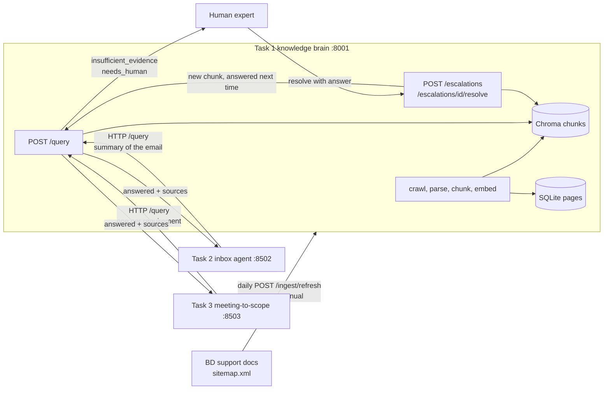

# Design

## Goals and constraints

- Build an AI consultant for a Brilliant Directories (BD) website business in one evening per task.
- Never let the assistant invent product facts: every product answer must come from the official
  support documentation, or the system must say it does not know and escalate.
- Keep the three tasks independent. Tasks 2 and 3 talk to Task 1 only over HTTP and never import
  its code, so Task 1 can be replaced or redeployed on its own.
- Python 3.11, type hints everywhere, `async` for network calls, prompts as versioned `.md` files.

## System overview

```
                 sitemap.xml  ──crawl──▶  SQLite pages ──parse/chunk/embed──▶  Chroma chunks
                                                 │                                   ▲
                                        screenshots ──Haiku caption──▶ caption chunks │
                                                                                     │
  Task 2 inbox agent ──HTTP /query──▶  Task 1 knowledge brain (FastAPI) ◀──HTTP /query── Task 3 meeting-to-scope
  Streamlit :8502                       :8001   retrieve ▸ threshold ▸ Sonnet answer       Streamlit :8503
  SQLite drafts + learning              SQLite escalations                                 SQLite projects/versions
```

The same picture as a sequence, including the daily refresh and the expert-escalation loop:



Tasks 2 and 3 only ever use `httpx` against the Task 1 URL from `.env`; if Task 1 is down they
show a red error instead of answering from memory.

Each task has its own SQLite file and virtualenv. One `.env` at the repo root configures all
three; one `prompts/v1/` folder holds every prompt.

## Task 1: knowledge brain

**Ingest.** `app/ingest.py` runs the same path for the first crawl and for `POST /ingest/refresh`:

1. Read the sitemap. Only `/solutions/articles/` URLs are crawled; category pages are stored as
   `skipped` so the table still records every URL.
2. Crawl politely: an `asyncio.Semaphore(3)` caps concurrency and a shared `RateLimiter` enforces
   a 0.5 s gap between request starts across all workers. Fetches retry three times with
   exponential backoff on 429/5xx/network errors; 404s are not retried.
3. Resume for free: a page is `pending`, `done`, `failed`, `inactive` or `skipped`, with an
   `attempts` counter. Each run processes `pending`/`failed` rows under `MAX_ATTEMPTS`, up to the
   `MAX_PAGES` budget minus pages already done. Stopping half way loses nothing.
4. Parse with BeautifulSoup: title from `h1`, body from `article.article-body`, images only from
   inside the body (site banners are excluded), and the "Link:" line removed.
5. Change detection: a SHA-256 of title+body. On refresh, a page whose sitemap `lastmod` changed
   is re-fetched; only a changed hash triggers re-chunking and re-embedding. URLs that left the
   sitemap are marked `inactive` and their chunks deleted, so they never appear in answers.
6. Chunk at headings (`h2`/`h3`/`h4`), splitting sections over 1,500 characters on paragraph
   boundaries. Every chunk carries `title`, `url`, `section` and `kind` metadata, and is embedded
   as `title + section + text` so retrieval sees the context. Chunk IDs hash `url|section|position`;
   position (not heading) makes them unique when an article repeats a heading.
7. Embeddings are local (`all-MiniLM-L6-v2`, normalized) and stored in a persistent Chroma
   collection with cosine distance, so `score = 1 - distance`.
8. Screenshots: up to `MAX_IMAGES` images are described by Haiku and stored as `kind=image`
   chunks linked to their article. Captions already paid for are kept when an article changes.

**Answering.** `POST /query` embeds the question, takes the top `TOP_K` chunks, and drops any
below `SCORE_THRESHOLD` (0.35 cosine). If nothing survives, it returns `insufficient_evidence`
with `needs_human: true` without calling the model at all. Otherwise Sonnet gets only the surviving
chunks and the `answer.md` prompt, which tells it to reply exactly `INSUFFICIENT_EVIDENCE` if the
context does not answer the question; that reply is mapped to the same abstain response. Sources
are de-duplicated by URL with the best score. The threshold was picked from observed scores:
true matches land around 0.6, off-topic questions around 0.3.

**Escalations.** `POST /escalations` stores the question. `POST /escalations/{id}/resolve` writes
the expert's answer as a `kind=escalation` chunk with URL `escalation://{id}`, so the next similar
question is answered from it (observed score 0.79 on a repeat of the same question).

**Models.** `ANSWER_MODEL` and `CAPTION_MODEL` come from `.env` so evals can swap them. The
response includes `model` and token `usage` so evals report real cost.

## Task 2: inbox agent

**Pipeline** (`inbox/pipeline.py`) for one email:

1. Haiku classifies into `{category, urgency, risk, summary}` using `classify.md`. Output is
   parsed tolerantly (fences and prose stripped) and validated with pydantic; one retry with the
   validation error appended.
2. If the category is a product question (`how_to`, `troubleshooting`, `follow_up`), the summary
   is sent to Task 1 `/query`. If Task 1 is unreachable the pipeline raises `KBUnavailable` and the
   UI shows a red error.
3. Sonnet drafts `{reply, sources, needs_human, next_action}` using `draft.md`, which receives the
   email, the classification and the raw Task 1 result.
4. Guardrails the model cannot override: `refund_cancel`, `complaint`, `quote_request` and `legal`
   always need a human; a product question with no answer or `insufficient_evidence` always needs
   a human, and the prompt requires the draft to say we will check and get back.
5. Everything is saved to the `drafts` table with `prompt_version` and the model pair.

**Learning rule** (`inbox/learning.py`, pure functions). Per category: `consecutive_clean`
sends without edit, `consecutive_edits`, and `auto_send_eligible`. Approve adds one clean send;
at `AUTO_SEND_THRESHOLD` (20) the category becomes eligible unless it is in
`NEVER_AUTO = {refund_cancel, complaint, quote_request}`. Edit or reject resets the clean count.
Two edits in a row switch eligibility off. Every flag change is written to `eligibility_log` and
printed. "Edit then send" with unchanged text counts as an approve, because `was_edited` compares
stripped draft and final text.

**UI** (`app.py`). Email list on the left (holdout emails hidden by default), original email,
classification, Task 1 sources and draft on the right, with Approve, Edit then send, and Reject
and write my own. Sending is simulated: it records the decision and prints the reply. The header
shows Task 1 health and the per-category counters and eligibility.

**Dataset.** `data/emails.json` holds 50 hand-written emails in seven categories; the last 10 are
`holdout: true` and are excluded from the eval.

## Task 3: meeting to scope

Five agents in `agents/`, orchestrated by `scope/pipeline.py`, each returning a pydantic model:

1. **Transcript analyst**: the transcript is split into 800-word chunks with 100-word overlap
   (`scope/chunking.py`); each chunk is extracted in parallel, then merged into requirements
   (`REQ-001`...), decisions, open questions and constraints such as deadline and budget.
2. **Feasibility**: each requirement is checked against Task 1 `/query` and classified as
   `existing_setting`, `partial`, `custom_dev` or `needs_clarification`, with the doc sources kept.
3. **Scope**: in-scope items, exclusions and acceptance criteria.
4. **Estimator**: low/likely/high hours per task. `existing_setting` items get 0.5 to 1 hour of
   configuration only; `custom_dev` items must have at least two tasks.
5. **Proposal**: a client-ready Markdown proposal. A regex check flags unhedged claims in
   committing sections (Proposed Solution, Deliverables, Timeline, Investment, Acceptance
   Criteria) that are not backed by feasibility evidence as `unverified_promises`.

**Follow-up meetings and change reports.** A project keeps versioned requirement sets and an
approved baseline. A follow-up transcript is analysed, then `scope/matching.py` matches each new
requirement to the baseline by ID when the wording is similar enough, otherwise by token
similarity, producing a `ChangeReport` of added, modified, removed, out-of-scope and unchanged
items plus constraint changes. Only affected items are re-estimated; unchanged items keep their
baseline estimate.

**UI** (`app.py`). Projects list, transcript upload, run pipeline, review the requirement table,
feasibility, estimate and proposal, approve a version as the baseline, and view change reports
for follow-ups. Three sample transcripts are in `data/transcripts/`: a discovery call and a
follow-up for the same client, and a second client's discovery call.

## Cross-cutting decisions

- **Prompts as files.** Every prompt is `prompts/<version>/<name>.md` with `{placeholders}` and
  is read at request time, so prompt changes need no restart and are versioned with git.
- **Claude backend switch.** Each task has a `claude_client.py` that returns an Anthropic or
  Bedrock async client depending on `AWS_BEARER_TOKEN_BEDROCK`, maps short model names to Bedrock
  inference-profile IDs, and sends the Bedrock body version those models require.
- **No sampling parameters.** Requests send only model, max_tokens and messages. JSON outputs are
  requested in the prompt and validated with pydantic rather than relying on model-side schemas,
  which keeps the two older models and both backends on one code path.
- **Everything local.** Embeddings are a local sentence-transformers model; storage is SQLite and
  on-disk Chroma. The only network dependencies are the docs site and the Claude API.

## Model choices

Both models are read from `.env`, so the evals could swap them without code changes. The split
below is what ships, and the numbers are from `EVALS.md` (same 160 cases, two models each).

| Step | Model | Why | Eval evidence |
|---|---|---|---|
| Task 1 answers | claude-sonnet-4-5 | Grounded answering from several chunks is where the stronger model earned its cost. | 20/20 vs Haiku 19/20; Haiku abstained on a two-article question. $0.0047 vs $0.0016 per case. |
| Task 1 screenshot captions | claude-haiku-4-5 | Short descriptions, 40 images, cost matters more than nuance. | Both caption-only eval questions answered by both models. |
| Task 2 classify | claude-haiku-4-5 | Cheaper, faster and more accurate on this dataset. | 39/40 (98%) vs Sonnet 37/40 (92%); 1.5 s vs 3.5 s median; $0.0007 vs $0.0022 per email. |
| Task 2 draft reply | claude-sonnet-4-5 | Drafts go to customers; tone and faithfulness to the retrieved docs matter. | Reviewed by a human in the UI; not separately scored. |
| Task 3 analyst and writer | claude-sonnet-4-5 | Long transcripts, merged requirements and a client-ready proposal. | 19/20 for both models; Sonnet costs 1.5x more per check but the A7 and C4 misses differ, so neither dominates. |
| Task 3 feasibility | claude-haiku-4-5 | One call per requirement; mostly mapping a Task 1 answer onto four classes. | All requirements received a feasibility entry (check A9) with both analyst models. |

Newer models (`claude-haiku-5-5`, `claude-sonnet-5-5`) exist and are already in the price
tables of the eval scripts; swapping them is a one-line `.env` change followed by a re-run.

## What I dropped and why

| Dropped | Instead | Why |
|---|---|---|
| Crawling all 1,540 articles | 450 pages indexed (`MAX_PAGES`), 1,090 left `pending` | One evening per task. The crawl is resumable, so the rest is one more `make ingest` per budget, not a redesign. |
| Captioning every screenshot (2,700+ images) | 40 captions (`MAX_IMAGES`), 40 failed, rest `pending` | Captions cost a model call each and most screenshots repeat the same admin pages. The eval shows captions are retrievable, which was the point to prove. |
| Real email sending in Task 2 | Simulated send: decision saved to SQLite and printed | Mailbox OAuth and deliverability are a project of their own and add risk with no eval value. The learning rule only needs the decision. |
| Postgres + managed vector DB | SQLite files + on-disk Chroma | Zero setup, one file per task, easy to reset and commit fixtures. Scale is hundreds of pages and tens of emails. |
| A reranker on top of vector search | Single cosine threshold (0.35) and top-k 6 | Threshold alone gave 100% abstains and 95 to 100% answers on the eval. A cross-encoder would help the two-article case but doubles ingest-time dependencies. |
| TypeScript for Task 2 | Python for all three tasks | One language, one `.env` loader, one pydantic style and one Streamlit UI pattern across tasks; no second toolchain to set up in a night. |
| Model-side JSON schemas | JSON asked for in the prompt, validated with pydantic, one retry | Keeps both older models and both backends (Anthropic, Bedrock) on one code path. |

## Known limitations

- Task 1 has indexed 450 of 1,540 articles; the rest are `pending` and one `make ingest` per
  `MAX_PAGES` budget picks them up. 40 of 80 attempted screenshot captions failed (the image could
  not be fetched or described) and are left as `failed` for a later retry.
- The retrieval threshold is a single cosine cut-off; a reranker would help the two-article
  questions that Haiku abstained on.
- Task 3 pipeline runs take about three minutes per transcript because the five agents run
  sequentially and the feasibility agent queries Task 1 once per requirement.
- Sending in Task 2 is simulated; there is no mailbox integration.
